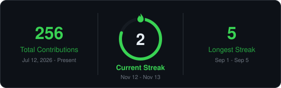
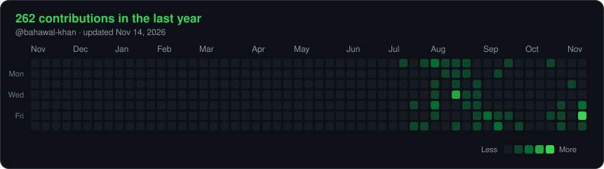
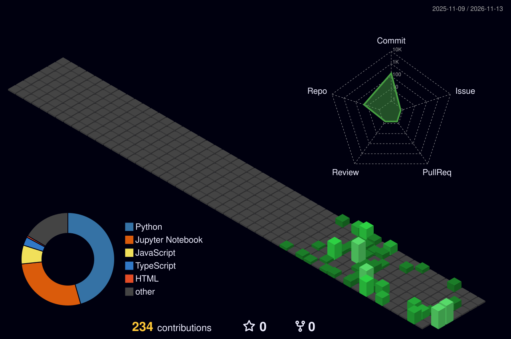
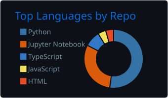
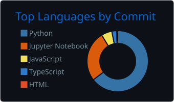
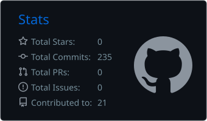
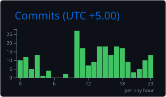

# Hi, I'm Bahawal Khan 👋

### 🤖 AI/ML Engineer &nbsp;|&nbsp; Machine Learning → Deep Learning → Generative AI → Agentic AI

📍 Lahore, Pakistan &nbsp;•&nbsp; 🎓 BSCS Student, University of Lahore

I build intelligent, full-stack AI applications — combining machine learning, LLMs, retrieval systems, and agentic workflows into real, usable products.

 

 

## 🧰 Tech Stack

 

 

## 🌐 Web Development

I also build the web layer that turns AI models into real, usable products.

 

## ⚙️ Backend & Database

 

## 🏗️ System Design & Scalable Architecture

Good AI products need more than a good model — they need to be **fast, scalable and secure**. I'm learning and applying high-level design (HLD) so what I build can handle real traffic.

 

**📐 High-Level Design**
- ⚖️ Load balancing & horizontal scaling
- 🗄️ Database sharding & replication
- ⚡ Caching strategies with Redis
- 📨 Event-driven systems & message queues with Kafka
- 🚦 Rate limiting, API gateways & CDNs
- 🔁 CAP theorem, consistency & fault tolerance
- 🔐 Secure by design: authentication (JWT/OAuth), input validation, secrets management
- 📈 Observability: logging, metrics & tracing

**🧪 Testing & Quality**
- ✅ Unit & integration testing
- 🚀 Load & performance testing
- 🔄 CI/CD pipelines with GitHub Actions
- 📏 LLM & RAG evaluation (see **RAG Eval** below)

 

## 🧭 Currently Exploring

- 🤖 Agentic AI & multi-step LLM workflows
- 🔎 Advanced RAG techniques (CRAG, Self-RAG) and automated RAG evaluation
- 🔗 LangGraph for stateful, production-grade agents
- 🏗️ System design: scaling, caching, sharding, replication & event-driven architecture
- 📊 AI evaluation & observability with LangSmith

 

## 🚀 Featured Projects

### 🎧 Customer Support AI
Intent, sentiment & priority detection with a fine-tuned DistilBERT model, plus a RAG pipeline for grounded responses.
**Macro F1: 0.9982**
 
`FastAPI` `LangChain` `RAG` `PostgreSQL`

---

### 🌱 PlantCare AI
Computer-vision plant disease classifier using EfficientNetB0 transfer learning on 54K+ leaf images.
**Val. Accuracy: 98.64%**
 
`TensorFlow` `Keras` `Computer Vision`

---

### 📉 ChurnAI
End-to-end churn prediction platform with SHAP explainability, an analytics dashboard, and production deployment.
**Recall: 82% · ROC-AUC: 0.78**
 
`Flask` `Next.js` `SHAP` `PostgreSQL`

---

### 🤖 Nexor AI
A multimodal agentic AI application built with LangGraph & LangChain — features persistent conversations via Postgres checkpoints, auth, and a FastAPI + React stack.
 
`LangGraph` `LangChain` `FastAPI` `React` `PostgreSQL`

---

### 🛍️ ShopAgent
An AI booking agent that supports both manual and fully automated bookings, with Human-in-the-Loop (HITL) approval built into the agent workflow.
 
`LangGraph` `Agentic AI` `HITL` `NLP`
 
🚧 Currently in working state

---

### 🧪 RAG Eval
An automated evaluation framework for RAG systems — test individual components (retrieval, generation) as well as the complete application end to end, instead of only judging the final answer.
 
`RAG` `LLM Evaluation` `Automation` `Python`

 

## 📊 GitHub Activity

  

  

**🧊 3D Contribution View**

  

 

## 💬 Let's Connect

  

### 💡 *"Turning ideas into intelligent, real-world AI systems."*

